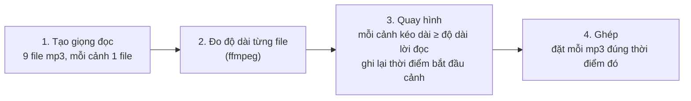

# Plan: Bài tập lớn CS112 — Minesweeper Solver Visualizer

> Mọi đường dẫn trong file này là **tương đối** tính từ thư mục `app_minesweeper_visualizer/`.

## 0. Yêu cầu bài tập lớn (cô nói ở Buổi 8)

Nguồn: transcript Buổi 8 (`../data/buoi8_clean.md`, khoảng dòng 41–57).

- Chọn 1 bài toán, xây ứng dụng **có giao diện** để **trực quan hóa** quá trình giải: nhập input → hiển thị từng bước → output.
- Được phép dùng AI hỗ trợ.
- Nộp đủ **3 thành phần**:
  1. Source code
  2. Video quay lại quá trình chạy thử
  3. Report tường thuật quy trình: tra cứu thế nào, dùng AI nào, prompt ra sao, thuật toán tự thiết kế hay AI đưa ra, **Input/Output rõ ràng + mã giả**
- Cô nhấn mạnh: Input/Output phải đặt tên biến, nói rõ kiểu dữ liệu, vai trò, giới hạn giá trị. Nếu Input/Output không rõ thì phần sau không chấm.
- Deadline thoải mái, miễn là nộp trước khi cô trả điểm về phòng đào tạo.

## 0.1. Bài đã chọn

- Bài **Dò Mìn** trên WeCode, lời giải: `../bai_tap/WeCode/giai_do_min_wecode.py`.
- **Luật:** số ở ô `(i, j)` = số mìn ở **4 ô kề cạnh** (hình chữ thập: trên, dưới, trái, phải). **Không tính ô chéo**, không tính chính nó. Vì vậy `a[i][j] ∈ {0..4}`.
- **Thuật toán:** chỉ quay lui trên hàng 0 (`2^M` phương án). Các hàng sau suy ra duy nhất theo công thức
  `b[r][c] = a[r-1][c] - b[r-2][c] - b[r-1][c-1] - b[r-1][c+1]`.
  Có 2 cận cắt nhánh: thu hẹp miền giá trị của `b[0][c]` và lan truyền theo đường chéo `(r, c-r)`. Độ phức tạp `O(2^M · N · M)`.

## 0.2. Quyết định thiết kế

| Vấn đề | Chọn | Lý do |
|---|---|---|
| Nền tảng | Web 1 file `index.html` (HTML/CSS/JS thuần) | Cô mở là chạy, không cần cài đặt, dễ quay video |
| Chạy từng bước | JavaScript generator (`function*`) + `yield` sự kiện | Tạm dừng, chạy từng bước, chỉnh tốc độ mà không treo trình duyệt |
| Giao diện | Tông tối trung tính, font JetBrains Mono + Plus Jakarta Sans, màu số theo game Dò Mìn | Bản đầu bị chê "nhìn AI quá" (gradient tím, hiệu ứng kính) |
| Kiểm tra trực quan | Rê chuột vào ô → tô sáng hình chữ thập trên cả 2 bảng | Thấy ngay quan hệ giữa `A` và `B` |
| Lưới ngẫu nhiên | Sinh `B` ngẫu nhiên trước rồi tính `A` | Bảo đảm luôn có nghiệm |
| Report | LaTeX theo template HW02 | Đồng bộ với các bài HW đã nộp |
| Video | Tự động: edge-tts + Playwright + ffmpeg | Xem mục 1–4 bên dưới |

## 0.3. Nhật ký lỗi (dùng cho mục "Quy trình với AI" trong report)

| # | Lỗi | Phát hiện | Sửa |
|---|---|---|---|
| 1 | Bản đầu tính theo **8 ô xung quanh**, sai luật đề (4 ô) → lưới random luôn vô nghiệm. Báo cáo nháp cũng ghi sai công thức | Bạn báo "sao không có cách giải hợp lệ", AI đọc lại code WeCode | Viết lại bộ sinh random, công thức `(*)`, `a ∈ {0..4}` |
| 2 | Test 1 cũ `[[1,1,1],[2,0,2],[1,1,1]]` **vô nghiệm thật**: ô tâm = 0 ⇒ `b01 = b10 = 0`, nhưng `a00 = 1` cần `b01 + b10 = 1` | Chứng minh mâu thuẫn bằng tay | Sinh test mẫu từ một `B` có trước, kiểm chứng bằng bản Python |
| 3 | Giải xong không hủy generator → bấm "Bắt Đầu Giải" lần 2 nhận `undefined` → báo vô nghiệm ngay. Bấm "Từng Bước" khi đang chạy làm 2 luồng chồng nhau | Chạy riêng thuật toán JS trong Node.js thì đúng ⇒ lỗi nằm ở phần điều khiển UI | Hủy generator khi xong, khóa nút từng bước khi đang chạy, reset khi sửa ô |
| 4 | Ký hiệu LaTeX `$A_{N \times M}$` hiện thô trên web | Xem lại từng khung hình của video | Đổi sang HTML `<sub>`, `<sup>`, `×`, `∈` |
| 5 | Script quay video lỗi `UnicodeEncodeError` khi in đường dẫn có dấu tiếng Việt | Console Windows dùng bảng mã cp1252 | Chỉ in tên file |

## 0.4. Kiểm thử đã chạy

- Bản Python WeCode với Test 1, Test 2 → ra nghiệm.
- Bản JS chạy trong Node.js (không giao diện), gọi đúng hàm `togglePlay` của nút bấm:
  - Test 1–3: có nghiệm, giải 2 lần liên tiếp vẫn ra cùng kết quả, trùng với bản Python.
  - Test 4 (mọi ô = 4): vô nghiệm, đúng như dự kiến.
  - 200 lưới random từ 1×1 đến 6×6: **0** lần báo vô nghiệm sai.
- Chạy lại: `node app_minesweeper_visualizer/demo/test_solver.js app_minesweeper_visualizer/index.html` (chạy từ thư mục cha).

## 0.5. Việc bạn cần tự làm trước khi nộp

- [ ] Upload `report/overleaf_upload.zip` lên Overleaf → compile ra PDF (máy hiện chưa cài `pdflatex`).
- [ ] Điền các chỗ **chữ đỏ** trong report: ngày nộp, link video, giới hạn `N, M` theo đề WeCode, lời giải WeCode tự viết hay AI hỗ trợ (đã AC chưa), nhận xét cá nhân ở mục 6.4.
- [ ] Upload `demo/demo_video.mp4` lên Drive hoặc YouTube, lấy link.
- [ ] (Tùy chọn) Lồng tiếng bằng giọng thật, xem mục 4.
- [ ] Đọc kỹ lại mục 3 của report (nhận xét hàng 0 + 2 cận), vì cô có thể hỏi "thuật toán tự thiết kế hay AI đưa ra".

> `Bao_Cao_Bai_Tap_Lon_Do_Min.md` là **bản nháp cũ, đã bị thay thế** bởi `report/Bao_Cao_Bai_Tap_Lon.tex`. Bảng "Nhật ký AI" trong bản nháp là nội dung **minh họa, không có thật**, không dùng để nộp.

---

# Phần video: giọng đọc AI và canh nhịp

## Cấu trúc thư mục

```text
app_minesweeper_visualizer/
├── index.html                  # Ứng dụng trực quan hóa (mở trực tiếp bằng trình duyệt)
├── plan.md                     # File này
├── Bao_Cao_Bai_Tap_Lon_Do_Min.md  # Bản nháp cũ, không dùng
├── demo/
│   ├── record_demo.py          # Quay video tự động có giọng đọc + phụ đề
│   ├── capture_screenshots.py  # Chụp ảnh minh họa cho báo cáo
│   ├── test_solver.js          # Kiểm thử thuật toán + luồng nút bấm bằng Node.js
│   ├── demo_video.mp4          # Video đầu ra
│   └── build/                  # File tạm: 9 file mp3 lời đọc + video thô (.webm)
└── report/
    ├── Bao_Cao_Bai_Tap_Lon.tex # Báo cáo LaTeX
    ├── img/                    # Ảnh chụp app dùng trong báo cáo
    └── overleaf_upload.zip     # .tex + img/ để upload lên Overleaf
```

## 1. Công cụ tạo giọng đọc

- Thư viện Python **[edge-tts](https://github.com/rany2/edge-tts)**: gọi dịch vụ "Read Aloud" của Microsoft Edge, dùng giọng **Azure Neural TTS**.
- Miễn phí, không cần tài khoản hay API key, **cần internet**.
- Giọng tiếng Việt:
  - `vi-VN-NamMinhNeural` (nam, đang dùng)
  - `vi-VN-HoaiMyNeural` (nữ)
- Tốc độ đọc: tham số `rate` (hiện để `"+5%"`).

Nghe thử một giọng:

```powershell
edge-tts --voice vi-VN-HoaiMyNeural --text "Xin chào cô" --write-media thu.mp3
```

### Thư viện cần có

```powershell
pip install playwright edge-tts imageio-ffmpeg
python -m playwright install chromium
```

`imageio-ffmpeg` có sẵn ffmpeg đi kèm, không cần cài ffmpeg riêng hay quyền admin.

## 2. Cách giọng đọc khớp với hình

Nguyên tắc: **tạo tiếng trước → quay hình sau → canh hình theo tiếng**.



| Bước | Hàm trong `demo/record_demo.py` | Việc làm |
|---|---|---|
| 1 | `synthesize()` | edge-tts đọc lời của từng cảnh trong `SCENES`, lưu ra `build/NN_<tên>.mp3` |
| 2 | `audio_duration()` | ffmpeg đọc ra thời lượng từng file mp3 |
| 3 | `record()` | Playwright chạy app và quay hình. Mỗi cảnh ghi lại thời điểm bắt đầu (`offsets`) |
| 4 | `mux()` | ffmpeg đặt từng mp3 vào đúng `offset` (`adelay`), trộn tiếng (`amix`), xuất MP4 |

### Đoạn code canh nhịp

```python
offsets.append(time.monotonic() - d.t0)        # cảnh này bắt đầu ở giây thứ mấy
await d.caption(text)                           # hiện phụ đề
await asyncio.gather(scene_actions(d, name),    # thao tác trên app
                     asyncio.sleep(dur + 0.5))  # và chờ hết lời đọc
```

`gather` chạy song song hai việc và đợi **việc nào lâu hơn** xong mới sang cảnh sau:

- Lời đọc dài hơn thao tác → hình đứng yên chờ đọc xong.
- Thao tác dài hơn lời đọc (thuật toán giải lâu) → có một khoảng lặng ngắn, lời đọc không bị cắt hay chồng sang cảnh sau.

Phụ đề, thao tác và tiếng dùng **chung một mốc thời gian** (`d.t0`, lấy ngay khi trang bắt đầu quay) nên tự khớp nhau, không cần canh tay.

### Chi tiết khác

- Video quay ở chế độ headless nên không có con trỏ chuột thật. Script vẽ thêm một **con trỏ giả màu vàng** và khung phụ đề bằng JavaScript (`OVERLAY_JS`).
- Kích thước video: 1600×900, 30 fps, H.264 + AAC.

## 3. Cách chạy và chỉnh sửa

Chạy từ thư mục cha của `app_minesweeper_visualizer/`:

```powershell
python app_minesweeper_visualizer/demo/record_demo.py        # quay lại video, mất khoảng 3 phút
python app_minesweeper_visualizer/demo/capture_screenshots.py # chụp lại ảnh cho báo cáo
```

| Muốn đổi | Sửa ở đâu |
|---|---|
| Lời thoại | Danh sách `SCENES` (tên cảnh, câu đọc) |
| Thao tác từng cảnh | Hàm `scene_actions()` |
| Giọng đọc | Hằng `VOICE` |
| Tốc độ đọc | `rate="+5%"` trong `synthesize()` |
| Độ phân giải | Hằng `SIZE` |

## 4. Tự lồng tiếng bằng giọng thật (tùy chọn)

- **Cách đơn giản:** mở `demo_video.mp4` bằng CapCut hoặc Clipchamp, tắt tiếng gốc, đọc theo phụ đề. Mỗi câu phụ đề hiện đúng bằng thời gian đọc nên đọc tốc độ bình thường là khớp.
- **Cách chính xác:** tự thu 9 file mp3, đặt tên giống các file trong `demo/build/`, rồi sửa script để bỏ bước `synthesize()` và đọc thẳng các file đó. Hình sẽ tự canh theo giọng thật.

## 5. Lưu ý về thông tin cá nhân

- Script chỉ in **tên file** ra màn hình, không in đường dẫn đầy đủ.
- Video và ảnh chụp chỉ quay nội dung trang web, không lộ thanh địa chỉ hay đường dẫn trên máy.
- `report/Bao_Cao_Bai_Tap_Lon.tex` **có họ tên và MSSV** (cần cho bài nộp). Cẩn thận khi chia sẻ công khai.
- Không ghi đường dẫn tuyệt đối (ổ đĩa, thư mục người dùng) vào tài liệu này hay vào báo cáo.
